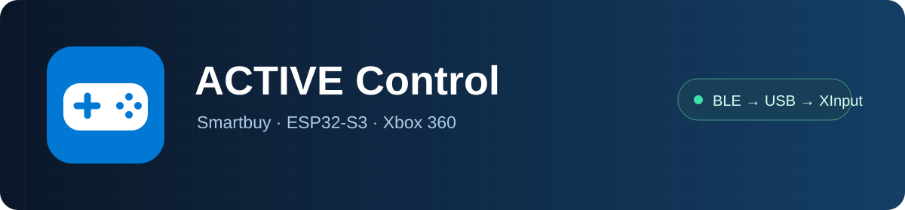
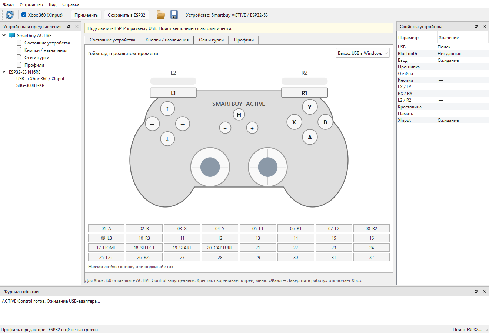
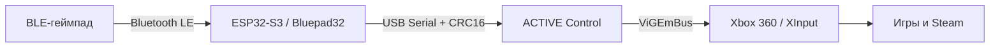

<div align="center">



**BLE-геймпад → ESP32-S3 → настоящий XInput на Windows**

[](#быстрый-старт)
[](docs/FIRMWARE.md)
[](docs/FIRMWARE.md)
[](LICENSE)

[**Скачать приложение**](https://github.com/MegaNoob24875/Smartbuy-Active-Bridge/releases/latest/download/ACTIVE-Control.exe) · [**Скачать прошивку**](https://github.com/MegaNoob24875/Smartbuy-Active-Bridge/releases/latest/download/SmartbuyBridge-v5-ESP32S3-N16R8.bin) · [Все релизы](https://github.com/MegaNoob24875/Smartbuy-Active-Bridge/releases)

</div>

ACTIVE Control превращает BLE-геймпад в Xbox 360 для ПК через ESP32-S3.
Приложение показывает подключение и живой ввод, позволяет менять кнопки,
мёртвые зоны, инверсию стиков и сохранять настройки в плате.

Разработано и проверено с **Smartbuy ACTIVE / SBG-300BT-KR** и платой
**ESP32-S3 N16R8 с разъёмами COM и USB**. Другие BLE-модели могут работать,
если их распознаёт Bluepad32; универсальная совместимость не заявляется.



## Что умеет

- Один виртуальный **Xbox 360 / XInput** для игр и Steam Big Picture.
- Кнопки A/B/X/Y, L1/R1, L2/R2, L3/R3, крестовина и оба стика.
- Настройка 32 кнопок, мёртвых зон, инверсии осей и обмена стиками.
- Профили JSON на ПК и постоянное сохранение настроек в NVS платы.
- Классический Windows-интерфейс: панели, вкладки, журнал событий и трей.
- Автоматическое обнаружение USB-порта и восстановление соединения.
- Готовый EXE: **устанавливать Python для запуска не нужно**.

## Как это работает



В v5 плата передаёт ввод и настройки через native USB CDC. Саму плату Windows
не считает вторым игровым контроллером. Xbox создаёт приложение на ПК.
Новые COM-порты при подключении к разъёму **USB** — нормальное поведение.

## Быстрый старт

1. Скачайте EXE и BIN из [Releases](https://github.com/MegaNoob24875/Smartbuy-Active-Bridge/releases/latest).
2. [Загрузите прошивку](docs/FIRMWARE.md) через разъём **COM** платы.
3. Один раз установите официальный [ViGEmBus 1.22.0](https://github.com/nefarius/ViGEmBus/releases/tag/v1.22.0). На уже настроенном ПК повторная установка не нужна.
4. Переставьте кабель в разъём **USB** и запустите `ACTIVE-Control.exe`.
5. Отключите геймпад от телефона, включите сопряжение и нажмите кнопку после подключения.
6. Дождитесь статуса Xbox и запускайте игру или Steam Big Picture.

**Оставляйте приложение работающим во время игры.** Крестик сворачивает его
в трей; «Файл → Завершить работу и отключить Xbox» полностью завершает работу.
Нужен USB-кабель с передачей данных. Номер COM-порта приложение выбирает само.

Настройки EXE, профили и журнал находятся в `%LOCALAPPDATA%\SmartbuyActiveControl`.
EXE не требует прав администратора; отдельное подтверждение UAC требуется
при первой установке драйвера ViGEmBus.

## Совместимость и ограничения

| Компонент | Поддержка |
|---|---|
| Проверенный геймпад | Smartbuy ACTIVE / SBG-300BT-KR, BLE HID |
| Проверенная плата | ESP32-S3 N16R8, 16 МБ Flash, OPI PSRAM |
| ПК | Windows x64; локальная проверка на Windows 11 |
| Другие геймпады | Только BLE и распознаваемые установленной версией Bluepad32 |
| Bluetooth Classic | **Не поддерживается ESP32-S3** |
| Игры вне Steam | Работают, если игра поддерживает Xbox/XInput; интернет не нужен |
| Игры только с клавиатурой | Эмуляции клавиатуры/мыши пока нет |
| Вибрация | Передача вибрации обратно на BLE-геймпад пока не реализована |

У Bluepad32 есть [список поддерживаемых контроллеров](https://bluepad32.readthedocs.io/en/latest/supported_gamepads/).
Наличие модели в общем списке не означает поддержку на S3: важен BLE-режим.
Для Xbox-контроллера интернет и Steam не обязательны. В Steam переназначение
кнопок зависит от выбранной раскладки; при конфликте можно отключить Steam
Input **только для конкретной игры**, оставив прямой XInput.

ViGEmBus — отдельный завершённый проект: используемый последний официальный
релиз — 1.22.0. Его установщик не встроен в EXE и не запускается автоматически.
EXE не подписан сертификатом издателя.

## Сборка и разработка

См. [сборку Windows EXE](docs/BUILD.md), [настройки Arduino и загрузку BIN](docs/FIRMWARE.md)
и [проверки и диагностику](docs/TESTING.md).

```text
active_control/      Python-приложение и USB Serial / XInput
SmartbuyBridge/      Полный Arduino-скетч с прошивкой v5
SmartbuyDiagnostics/ Дополнительная Bluetooth-диагностика
packaging/           PyInstaller spec и сведения о версии
tools/               Создание иконки и вспомогательные инструменты
docs/                Инструкции и изображения
```

В репозитории нет `.venv`, личных профилей, журналов или тяжёлых файлов сборки.
Готовые EXE и BIN распространяются через Releases. Исходный код проекта —
[MIT](LICENSE); лицензии зависимостей перечислены в [THIRD_PARTY_NOTICES.md](THIRD_PARTY_NOTICES.md).
